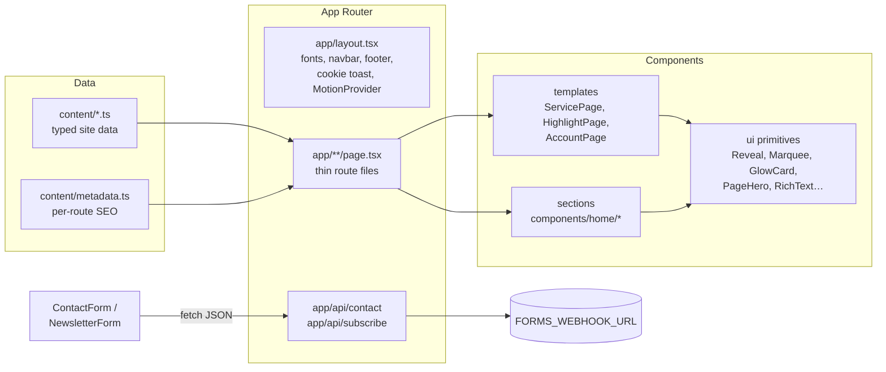

# Love Thy Neighbor Home Health Care — Website

The marketing website for **Love Thy Neighbor Home Health Care, Inc.** (Leesburg, FL), rebuilt from a GoDaddy Website
Builder site into a modern, statically-generated **Next.js 16** application with a dynamic, motion-rich design.
All wording, images, links and page metadata come from the original site; the layouts, interactions and
code are new.

---

## Table of contents

1. [At a glance](#1-at-a-glance)
2. [Getting started](#2-getting-started)
3. [Project history](#3-project-history)
4. [Tech stack and versions](#4-tech-stack-and-versions)
5. [Architecture](#5-architecture)
6. [Directory structure](#6-directory-structure)
7. [Routes](#7-routes)
8. [Content layer (`content/`)](#8-content-layer-content)
9. [Design system](#9-design-system)
10. [Dynamic UI patterns — where and how](#10-dynamic-ui-patterns--where-and-how)
11. [Page-by-page breakdown](#11-page-by-page-breakdown)
12. [Component reference](#12-component-reference)
13. [Library modules (`lib/`)](#13-library-modules-lib)
14. [Forms and API routes](#14-forms-and-api-routes)
15. [Page transitions (React `<ViewTransition>`)](#15-page-transitions-react-viewtransition)
16. [Accessibility and reduced motion](#16-accessibility-and-reduced-motion)
17. [SEO, metadata and static files](#17-seo-metadata-and-static-files)
18. [Performance](#18-performance)
19. [Next.js 16 specifics used in this project](#19-nextjs-16-specifics-used-in-this-project)
20. [Static assets (`public/`)](#20-static-assets-public)
21. [Quality checks performed](#21-quality-checks-performed)
22. [How-to guides](#22-how-to-guides)
23. [Deployment](#23-deployment)
24. [Known limitations and follow-ups](#24-known-limitations-and-follow-ups)

---

## 1. At a glance

| | |
| --- | --- |
| Framework | Next.js 16.4 (App Router, Turbopack, Cache Components) on React 19.3 |
| Styling | Tailwind CSS 4.3 (+ typography plugin), design tokens in `app/globals.css` |
| Motion | Motion 14 (`motion/react`) and native view transitions via React `<ViewTransition>` |
| Icons | Lucide 1.x, plus inline SVG brand icons (Facebook, Instagram, X) |
| Fonts | Manrope (body) and League Spartan (headings), self-hosted by `next/font` |
| Rendering | Every page is statically prerendered (36 build outputs); only the two form APIs are dynamic |
| Pages | 32 routes: home, about, 5 services, 3 highlight pages, insurance, FAQs, get started, blog index, 12 blog posts, 5 account pages, 404 |
| Content | Typed data modules in `content/` (no CMS, no database) |
| Forms | Contact and newsletter forms → `/api/contact`, `/api/subscribe` → optional webhook |
| Size | ≈ 5,250 lines of TypeScript/TSX/CSS across 72 source files |

---

## 2. Getting started

**Requirements:** Node.js 20.9 or newer (Next.js 16 minimum). Developed on Node 24 / npm 11.

```bash
npm install          # install dependencies
npm run dev          # development server → http://localhost:3000
npm run build        # production build (type-checks, prerenders every page)
npm start            # serve the production build
npm run lint         # ESLint (next/core-web-vitals + TypeScript rules)
npx tsc --noEmit     # type-check only
```

**Environment variables** (all optional):

| Variable | Used by | Purpose |
| --- | --- | --- |
| `FORMS_WEBHOOK_URL` | `lib/form-submissions.ts` | When set, contact and newsletter submissions are POSTed there as JSON (Zapier, Make, Slack, your own mail service…). When unset, submissions are only logged on the server. |

Create a `.env.local` file for local values (`.env*` files are git-ignored).

---

## 3. Project history

The project was built in two phases (see `git log`):

1. **Faithful port (commit `original version`).** The original GoDaddy site (`lovethyneighborhhc.com`) was crawled
   with a headless browser: all 32 pages at desktop and mobile widths, the live CSS object model, every
   interaction state (menus, drawer, slideshow, hours, form errors, blog filters), and every image and font from
   GoDaddy's CDN. That phase reproduced the site 1:1 in Next.js using GoDaddy's own markup and CSS.
2. **Redesign (current working tree).** The GoDaddy markup and CSS were replaced entirely. The content captured
   in phase 1 was extracted into typed data files (`content/`) and every page was rebuilt with new components,
   a new design system and dynamic UI.

The crawler and extraction scripts ran outside this repository; their output is the data in `content/` and the
downloaded files in `public/assets/`. Nothing at runtime depends on GoDaddy any more (except the optional
TrustedSite badge script, see [§24](#24-known-limitations-and-follow-ups)).

What the extraction preserved from the original site:

- All page text (rich text is sanitized to a small HTML subset, see [§8](#8-content-layer-content)).
- All images, in their highest-resolution downloaded variant (`next/image` generates responsive sizes).
- Business details: address, phone, email, map coordinates (28.8254936, −81.9086649, zoom 14), weekly hours.
- Navigation structure, footer links, social links, cookie-notice text.
- Every page's `<title>`, description, canonical URL, Open Graph and Twitter tags.
- All 12 blog posts, converted from GoDaddy's embedded Draft.js data to clean HTML, with dates and categories.
- Form success/error messages configured on the original GoDaddy widgets.

---

## 4. Tech stack and versions

| Package | Version | Role |
| --- | --- | --- |
| `next` | 16.4.0 | Framework (App Router, Turbopack builds, `next/image`, `next/font`, metadata API) |
| `react`, `react-dom` | 19.3.0 | UI runtime; `ViewTransition` component, `useSyncExternalStore` |
| `motion` | ^14.1.0 | Animations (`motion/react` re-exports framer-motion: `motion`, `AnimatePresence`, `useScroll`, `useTransform`, `useSpring`, `LayoutGroup`, `MotionConfig`) |
| `lucide-react` | ^1.55.0 | Icon set (1.x no longer ships brand logos, hence `components/ui/BrandIcons.tsx`) |
| `tailwindcss`, `@tailwindcss/postcss` | ^4.3.3 | Utility CSS; configured CSS-first in `app/globals.css` via `@theme` |
| `@tailwindcss/typography` | ^0.5.20 | `prose` styles for rich text (service bodies, blog articles) |
| `typescript` | ^5 | Strict mode |
| `eslint`, `eslint-config-next` | ^9 / 16.4.0 | Linting, including the React-Compiler-era `react-hooks` rules |

Configuration files:

- `next.config.ts`: `cacheComponents: true` and `partialPrefetching: true` (Next 16 defaults from `create-next-app`).
- `postcss.config.mjs`: registers `@tailwindcss/postcss`.
- `tsconfig.json`: strict, `@/*` path alias → project root.
- `eslint.config.mjs`: `next/core-web-vitals` + `next/typescript`.

---

## 5. Architecture



Key principles:

- **Content is data.** Pages never hard-code copy; they import it from `content/`. Changing wording or images
  means editing one data file.
- **Route files stay thin.** Repeated page types (5 services, 3 highlights, 5 account pages) share a template
  component; each route file only selects its content and metadata.
- **Server components by default.** Only components that need state, effects, pointer tracking or scroll
  progress are client components (`'use client'`). For example, the blog grid's cards are rendered on the
  server and handed to the client-side filter as props.
- **Static output.** No page reads cookies, headers or search params on the server, so everything prerenders.
- **Progressive motion.** Content is fully present in the HTML; motion only enhances it, and is reduced for
  visitors who ask for that.

---

## 6. Directory structure

```
app/
  layout.tsx                 Root layout: <html lang="en-PH">, fonts, global metadata, providers, navbar, footer
  globals.css                Tailwind import, theme tokens, keyframes, utilities, view-transition CSS
  page.tsx                   Home
  about/                     About
  skilled-nursing-care/      ┐
  non-skilled-care/          │
  private-duty-nursing/      ├ Service pages → components/services/ServicePage
  pediatric-private-nurse/   │
  concierge-services/        ┘
  individualized-care-plans/ ┐
  reduced-hospital-re-ad/    ├ Highlight pages → components/highlights/HighlightPage
  patient-experience-and/    ┘
  insurance-information/     Insurance (logo marquees + glow grid + CTA)
  faqs/                      FAQ accordion
  how-to-get-started/        Contact form + business details + map
  blogs/                     Blog index (featured post, category tabs, grid)
    f/[slug]/                Blog post (12 statically generated slugs)
  m/                         Account pages: login, account, reset, create, create-account
  not-found.tsx              404
  api/contact/route.ts       POST contact form
  api/subscribe/route.ts     POST newsletter signup

components/
  layout/    SiteNavbar, SiteFooter, CookieConsent, ScrollProgress, MotionProvider
  home/      HomeHero, CredentialsMarquee, CareHighlights, PrioritySplit, ServicesShowcase,
             CtaBand, ContactSection, NewsletterSection
  services/  ServiceCard, ServicePage
  highlights/HighlightPage, HighlightTimeline
  about/     StoryCollage, RevealCard
  blog/      PostCard, BlogBrowser
  faq/       FaqAccordion
  account/   AccountPage, AccountForm
  contact/   HoursList, MapEmbed
  forms/     ContactForm, NewsletterForm, FloatingField, messages.ts
  ui/        Reveal, SectionHeading (+Eyebrow), Button, RichText, Marquee, GlowCard, Magnetic,
             PageHero, PageTransition, BrandIcons

content/     types.ts + one data module per area (see §8)
lib/         dates, hours, form-submissions, use-media-query, use-prefers-reduced-motion
public/      assets/images, assets/fonts, manifest.webmanifest, robots.txt, sitemap*.xml
```

---

## 7. Routes

| Route | File | Template / main components | Metadata key |
| --- | --- | --- | --- |
| `/` | `app/page.tsx` | HomeHero, CredentialsMarquee, CareHighlights, PrioritySplit, ServicesShowcase, CtaBand, ContactSection, NewsletterSection | `/` |
| `/about` | `app/about/page.tsx` | PageHero, StoryCollage, RevealCard ×2, CtaBand | `/about` |
| `/skilled-nursing-care` | `app/skilled-nursing-care/page.tsx` | ServicePage | same path |
| `/non-skilled-care` | … | ServicePage | same path |
| `/private-duty-nursing` | … | ServicePage | same path |
| `/pediatric-private-nurse` | … | ServicePage | same path |
| `/concierge-services` | … | ServicePage | same path |
| `/individualized-care-plans` | … | HighlightPage | same path |
| `/reduced-hospital-re-ad` | … | HighlightPage | same path |
| `/patient-experience-and` | … | HighlightPage | same path |
| `/insurance-information` | `app/insurance-information/page.tsx` | PageHero, Marquee ×2, GlowCard grid, CTA split | same path |
| `/faqs` | `app/faqs/page.tsx` | PageHero, sticky contact card, FaqAccordion | same path |
| `/how-to-get-started` | `app/how-to-get-started/page.tsx` | PageHero, ContactForm, HoursList, MapEmbed | same path |
| `/blogs` | `app/blogs/page.tsx` | PageHero, BlogBrowser, PostCard, social section | same path |
| `/blogs/f/[slug]` | `app/blogs/f/[slug]/page.tsx` | PageHero (image morph), RichText, sticky sidebar, prev/next | `/blogs/f/<slug>` |
| `/m/login`, `/m/account` | `app/m/*/page.tsx` | AccountPage (sign in) | same path |
| `/m/reset`, `/m/create` | … | AccountPage (set password) | same path |
| `/m/create-account` | … | AccountPage (create account) | same path |
| any unknown URL | `app/not-found.tsx` | animated 404 | `/404` |
| `POST /api/contact` | `app/api/contact/route.ts` | dynamic | — |
| `POST /api/subscribe` | `app/api/subscribe/route.ts` | dynamic | — |

URLs are identical to the original site (including the original's truncated slugs such as
`/reduced-hospital-re-ad` and `/patient-experience-and`), so existing links and search results keep working.

---

## 8. Content layer (`content/`)

All copy, images and metadata live in typed modules. The shapes are defined in `content/types.ts`:

| Type | Shape |
| --- | --- |
| `Img` | `{ src, width, height, alt }`, where `src` points into `public/assets/images` and the intrinsic size is for `next/image` |
| `Rich` | Sanitized HTML string (`p, strong, em, a, br, ul, ol, li, h2–h4, blockquote, figure/img, hr`) |
| `Link` | `{ label, href }` |
| `Section` | `{ heading, body: Rich }` |
| `DayHours` | `{ day, short, open: 'HH:MM' \| null, close: 'HH:MM' \| null }` |
| `Service` | `{ slug, title, navLabel, image, summary, sections, cta: { heading, body, button } }` |
| `Highlight` | `{ slug, title, sections }` |
| `Field`, `AccountPage` | Form field definitions (name, label, type, required, autoComplete) and account page copy |
| `BlogPost` | `{ slug, title, date (ISO), image, categories, excerpt, html, readingMinutes }` |

| Module | Contents |
| --- | --- |
| `site.ts` | Business name and domain; phone (`+1 352-787-0499`, `tel:+13527870499`); email; full address; map coordinates and zoom; 7-day structured hours and labels; social links and "Connect With Us" title; copyright line; footer links; cookie-notice title, message and button |
| `navigation.ts` | Hand-written: `primaryNav` (Home, About, Services ▾, Insurance Information, FAQs, How to Get Started, Blogs), `services` submenu, `accountLinks`, hero helpers (`phone`, `hours`, `location`) and `isActive(pathname, href)` |
| `home.ts` | `careHighlights` (section title and 3 cards: title, description, link, image) and `home` (split section, services title, two-line CTA, contact section copy, newsletter copy) |
| `about.ts` | Title, headline, rich body (4 paragraphs), Mission and Vision cards with images |
| `services.ts` | The 5 services (`getService(slug)`); `summary` is the first paragraph, used on cards and hero |
| `highlights.ts` | The 3 highlight pages with 3 sections each (`getHighlight(slug)`) |
| `insurance.ts` | Title, 8 insurer logos, "We're Here for You" CTA (eyebrow, title, body, button → `/how-to-get-started`, image) |
| `faqs.ts` | Title and Q&A items |
| `get-started.ts` | Page title, form title ("Let Us Support You!"), intro, business name, submit label |
| `account.ts` | `login`, `account`, `reset`, `create`, `create-account`: title, message, fields, submit label, links, note |
| `not-found.ts` | 404 title, message and button |
| `blog.ts` | Blog title, categories (`All Posts`, `Health`), "Continue Reading" label, 12 posts newest first, `getPost(slug)` |
| `metadata.ts` | `pageMetadata`: Next.js `Metadata` objects for all 32 original routes (title, description, canonical, Open Graph, Twitter, local OG images) |

**Rich text safety.** HTML strings were sanitized when they were extracted: only the tags listed above survive,
every class/style/data attribute was removed, GoDaddy wrappers were unwrapped, empty paragraphs were dropped,
and external links got `target="_blank" rel="noopener noreferrer"`. `components/ui/RichText.tsx` renders them with
`dangerouslySetInnerHTML`. That's safe because the data is static and authored in this repository; keep it
that way if you edit HTML by hand.

---

## 9. Design system

Defined CSS-first in `app/globals.css`.

### Colors (`@theme`)

| Token | Value | Use |
| --- | --- | --- |
| `brand-50 … brand-950` | `#eef6fc` → `#0a2139`, with `brand-600 = #115793` | The original site's theme blue and its scale: headings, buttons, dark sections |
| `accent-300 … accent-600` | `#ffc078` → `#e57712` (`accent-500 = #f7931e`) | Warm orange from the logo: highlights, CTAs on dark backgrounds |
| `teal-brand` | `#5cc8c2` | Teal from the logo ring: gradients, glows |

Defaults: page background white, body text `slate-700`, text selection uses `brand-600`.

### Typography

- `--font-sans`: **Manrope** (body, UI). `--font-display`: **League Spartan** (headings; it was the
  original site's heading font).
- Loaded by `next/font/google` in `app/layout.tsx` and exposed as CSS variables on `<html>`. They must be
  on `<html>`: Tailwind defines `--font-sans` on `:root`, and a variable referenced there must be defined on the
  same element.

### Shadows, easing, utilities

| Token / utility | Purpose |
| --- | --- |
| `shadow-soft`, `shadow-card` | Soft blue-tinted elevation for cards and panels |
| `shadow-glow` | Hover glow ring used by cards |
| `ease-out-expo` | `cubic-bezier(0.16, 1, 0.3, 1)`, the house easing for reveals and transitions |
| `glass` | Frosted light surface (`bg-white/70`, blur, white border) |
| `glass-dark` | Frosted surface for dark backgrounds |
| `text-gradient` | Brand-blue → teal gradient text |

### Animations

| Utility | Keyframes | Used by |
| --- | --- | --- |
| `animate-progress` | `scaleX 0→1` over `--progress-duration` | Hero slide progress bars |
| `animate-marquee` / `-reverse` | translate −50% (minus half the gap) | `Marquee` |
| `animate-float` | gentle ±10px bob | Newsletter icon, aurora blobs (via arbitrary `animate-[float_…]`) |
| `animate-spin-slow` | 18s rotation | Dashed decorative rings |

### Base layer

Smooth scrolling, font smoothing, `scroll-margin-top: 96px` on every `[id]` (anchors land below the sticky
navbar), and a visible `:focus-visible` outline in `brand-500`.

### Recurring visual language

Rounded "pill" buttons; 1.75–2.5rem radius cards; eyebrow labels (small, uppercase, letter-spaced, with a rule
line); deep-navy hero bands with drifting blurred "aurora" blobs and a faint grid; brand gradients; numbered
items (01, 02, …).

---

## 10. Dynamic UI patterns — where and how

| Pattern | Where | Implementation |
| --- | --- | --- |
| **Vertical stacking cards** | Home, "Better Skills - Better Care - Better Results" (desktop and mobile) | `CareHighlights`: each card is `position: sticky` with a growing `top` (`--stack-top + index × --stack-step`: 112/136/160px desktop, 88/106/124px mobile) and rising `z-index`. Covered cards scale down 4.5% per layer and dim via `useScroll` + `useTransform`. A spacer `<li>` holds the fully stacked state. |
| **Horizontal scroll (pinned)** | Home, "The Services We Offer" | `ServicesShowcase`: the section's height becomes `100vh + track overflow`; a sticky full-screen frame translates the card track with `useTransform(scrollYProgress)`; there's a progress bar; a `ResizeObserver` keeps the distance right. Below 1024px (or with reduced motion) it's a native snap carousel. |
| **Swipe / snap carousels** | Home services (mobile), "related services" on service pages | `overflow-x-auto snap-x snap-mandatory`, hidden scrollbars |
| **Infinite marquees** | Under the hero (credentials), footer (services), insurance (two rows, opposite directions) | `Marquee`: pure CSS, content duplicated once, edge fade mask, pauses on hover |
| **Hover reveal** | Service cards (summary slides up), About Mission/Vision cards (text rises in a glass panel) | CSS `grid-template-rows: 0fr → 1fr` transitions; also triggered by keyboard focus; always visible on touch layouts |
| **Pointer glow** | Insurance logo grid, highlight related cards, service CTA card | `GlowCard`: pointer position → CSS vars `--x/--y` → radial glow surface and a masked glowing border |
| **Magnetic button** | Home and About CTA band | `Magnetic`: spring-follows the mouse, springs back on leave; disabled for touch and reduced motion |
| **Parallax** | "Your health is our priority" photo and badge, About photo collage | `useScroll({ target })` + `useTransform` on `y` / `rotate` |
| **Sticky sidebar scrolling** | Service pages (services nav + call card), About (collage beside the story), blog posts (categories/recent/share), FAQ (contact card), contact sections (form card), stacking-card title | `lg:sticky lg:top-28 lg:self-start` |
| **Scroll-linked timeline** | Highlight pages | `HighlightTimeline`: a spring-smoothed line fill driven by scroll; each step's marker color/scale and card opacity/offset follow its own scroll progress |
| **Scroll reveal** | Nearly every heading, card and block | `Reveal`: `whileInView` fade + rise once, 12% before entering the viewport |
| **Glassmorphism** | Navbar, cookie toast, contact form cards, hero floating cards, PageHero image frame, social buttons, account card | `glass` / `glass-dark` utilities, `backdrop-blur` |
| **Hero slideshow** | Home | `HomeHero`: 4 photos crossfade every 7s (the original's timing) with a slow zoom; clickable progress-bar tabs; floating hours/location cards |
| **Animated tabs and layout filtering** | Blog index | `BlogBrowser`: shared-layout pill (`layoutId`), `AnimatePresence mode="popLayout"` re-flowing grid |
| **Accordion** | FAQ | `FaqAccordion`: one panel open, height animation, rotating plus icon |
| **Page transitions and image morphs** | All pages | React `<ViewTransition>` (see [§15](#15-page-transitions-react-viewtransition)) |
| **Scroll progress bar** | All pages | `ScrollProgress`: spring-smoothed `scaleX` gradient bar fixed to the top edge |
| **Animated aurora backgrounds** | PageHero, CTA band, newsletter, account pages, 404 | Large blurred circles with slow `float` animations, dot/grid overlays with radial masks |
| **Micro-interactions** | Buttons (lift, icon rotate), arrows (nudge), images (slow zoom), floating labels on inputs, animated form success states | Tailwind transitions + Motion springs |

---

## 11. Page-by-page breakdown

### Home (`/`)

1. **HomeHero**: two columns. Left: a pulsing "Love Thy Neighbor Home Health Care, Inc" pill, the headline
   *Better Skills, Better Care, Better Results* (the last phrase in gradient text), the line "Your health and
   comfort matter—…", **Call Us** (tel) and **The Services We Offer** (`#services`) buttons, and credential chips
   (Medicare-certified, Medicaid-licensed, AHCA-licensed). Right: the original four hero photos in a square card.
   The originals carry baked-in text on their left half, so they're anchored right and slightly zoomed (1.2 → 1.12)
   to hide it. Floating cards show hours (Mon – Fri, 09:00 am – 05:00 pm) and location (Leesburg, FL). The first
   slide loads eagerly with high fetch priority.
2. **CredentialsMarquee**: an infinite band of the five service names and three credentials.
3. **CareHighlights**: vertical stacking cards (see §10); each card has a number, an icon, a title, a description,
   a "Learn more" link and a photo that morphs into the highlight page hero. On desktop the section title sits in a
   sticky left column.
4. **PrioritySplit**: "In Love Thy Neighbor Home Health Care / Your health is our priority", with a parallax
   photo, a spinning dashed ring and a floating glass credential badge.
5. **ServicesShowcase**: the pinned horizontal scroller of the five `ServiceCard`s.
6. **CtaBand**: "Let us provide the care you deserve / Call today to speak with our team" on a glowing gradient
   band with a magnetic **CALL US · phone** button.
7. **ContactSection** (`#contact`): title, intro, rich body (email and fax), address/phone card, `HoursList`
   with today highlighted, Google Map, and a sticky glass **Drop us a line!** form card.
8. **NewsletterSection**: "Subscribe to our Newsletter" with an inline email form on an animated gradient mesh.

### About (`/about`)

PageHero (title, company eyebrow, headline as description) → a sticky three-photo **StoryCollage** with parallax
beside the scrolling story (the first paragraph is emphasized) → **Mission** and **Vision** `RevealCard`s →
`CtaBand`.

### Service pages (5 routes → `ServicePage`)

PageHero with breadcrumb, "Service 0X / 05" eyebrow, summary, an accent **Call us** button and the service photo
(morph target `service-<slug>`) → two columns: a sticky sidebar (all services with the current one highlighted,
plus a dark call card with phone and live hours) and the "How it works" rich content with checkmark lists → a
glowing CTA card ("Call us today to learn how we can help") → a "The Services We Offer" carousel of the four
other services.

### Highlight pages (3 routes → `HighlightPage`)

PageHero (eyebrow "Better Skills - Better Care - Better Results", the home card's description, its photo as
morph target `highlight-<slug>`) → `HighlightTimeline` with the page's three sections → the other two highlights
as `GlowCard` links.

### Insurance Information

PageHero → two logo marquees in opposite directions → a 4-column `GlowCard` grid where logos go from muted
grayscale to full color on hover → "Get in Touch with Us / We're Here for You" with a tilted photo, an overlapping
glass card and a **CONTACT US** button to `/how-to-get-started`.

### FAQs

PageHero → a sticky dark contact card (intro, phone, email, **How to Get Started**) beside the `FaqAccordion`.

### How to Get Started

PageHero (intro as description) → a sticky glass **Let Us Support You!** form beside business-name / address /
phone cards, weekly hours and the map.

### Blog index (`/blogs`)

PageHero → `BlogBrowser`: animated **All Posts / Health** tabs. "All Posts" shows the newest post as a large
featured card followed by the other 11; "Health" shows its two posts. Then a "Connect With Us" section with glass
social buttons.

### Blog post (`/blogs/f/[slug]`)

PageHero with breadcrumb (Blogs → title), excerpt, date and reading time, and the featured photo (morph target
`post-<slug>`) → the article (`RichText` at `prose-lg`) beside a sticky sidebar (categories, 3 recent posts with
thumbnails, Facebook/X share links) → previous/next post cards. All 12 slugs are generated at build time.

### Account pages (`/m/*`)

A centered glass card over an aurora background: logo, title, message, `AccountForm` (floating-label fields,
validation including password confirmation) and links ("Reset password", "Not a member? Create account.",
"Already have an account? Sign in"). See [§24](#24-known-limitations-and-follow-ups) for why submission ends in a
"please call us" notice.

### 404

A large gradient "404", the original "Page Not Found" text and a **Go To Home Page** button over animated blobs.

---

## 12. Component reference

### `components/layout/`

| Component | Type | Details |
| --- | --- | --- |
| `SiteNavbar` | client | Sticky header named `site-header` for view transitions. Frosted background that gains a shadow and shrinks (72 → 64px) after 8px of scroll. Desktop nav from 1280px (`xl`) with active-route pills (`isActive`, `aria-current`). **ServicesMenu**: opens on hover or click, closes on outside click and Escape, animated panel with an icon per service. **AccountMenu**: Sign In / Create Account. **Get in Touch** tel pill. **MobileSheet** (below `xl`): rendered through a portal into `<body>` (the header's `backdrop-filter` would otherwise trap the fixed overlay); spring slide-in panel, blurred backdrop, body scroll lock, Escape to close, Services accordion (pre-opened on service pages), staggered items; closes on navigation by comparing pathname during render. |
| `SiteFooter` | server | Services marquee (links), white logo, intro line, social buttons, Quick Links (original footer links minus services; labels from `navigation.ts`), Services list, contact column (address, phone, email, grouped hours "Mon – Fri / Sat – Sun"), copyright and domain. |
| `CookieConsent` | client | Glass toast with the original cookie text; appears 1.2s after load unless the `cookie_terms=accepted` cookie exists; **Accept** sets it for one year (`SameSite=Lax`). |
| `ScrollProgress` | client | `useScroll` → `useSpring` → `scaleX` on a fixed gradient bar. |
| `MotionProvider` | client | `<MotionConfig reducedMotion="user">` for the whole app. |

### `components/ui/`

| Component | Type | Props / behavior |
| --- | --- | --- |
| `Reveal` | client | `delay`, `y` (28), `x`, `as` (`div`/`li`/`section`/`article`/`span`); fades and slides in once when 12% inside the viewport; renders identically on server and client. |
| `SectionHeading`, `Eyebrow` | server | Eyebrow label with rule lines (light/dark tones, optional centering); heading + description block. |
| `Button` | server | `href`, `variant` (`primary`, `accent`, `secondary`, `light`, `ghost`), `size` (`md`, `lg`), `icon` (in a rotating circle), `iconRight` (nudges on hover). Internal hrefs use `next/link`; `tel:`, `mailto:` and external use `<a>`. |
| `RichText` | server | Renders a `Rich` string with Tailwind Typography; brand link and heading styles; custom ✓ bullets for `ul`; `tone="dark"`, `size="lg"`. |
| `Marquee` | server | `duration` (s), `reverse`, `gap` (px), `fade`; CSS-only infinite loop that pauses on hover. |
| `GlowCard` | client | `color`, `as`; pointer-following radial glow on the surface and border; `hover:shadow-glow`. Exposes the `group/glow` variant to children. |
| `Magnetic` | client | `strength` (0.35); spring offset toward the mouse. |
| `PageHero` | server | `title`, `eyebrow`, `description`, `crumbs`, `image`, `imageTransitionName`, `children` (actions). Navy aurora band; centered layout without an image, two columns with one. |
| `PageTransition` | server | Wraps page content in `<ViewTransition enter="page" exit="page" default="none">`. |
| `BrandIcons` | server | `FacebookIcon`, `InstagramIcon`, `XIcon`, `socialIcon(label)`. |

### `components/home/`

| Component | Type | Notes |
| --- | --- | --- |
| `HomeHero` | client | 7000ms autoplay (`setTimeout` per slide), `AnimatePresence` crossfade, slow-zoom layer, progress-bar tabs (`role="tablist"`), floating cards; respects reduced motion. |
| `CredentialsMarquee` | server | Services and credentials chips. |
| `CareHighlights` | client | Stacking cards (sticky offsets via CSS variables, scale/dim transforms, spacer); images wrapped in `ViewTransition name="highlight-<slug>"`. |
| `PrioritySplit` | client | Parallax image (−8% → 8%) and badge (60 → −60px). |
| `ServicesShowcase` | client | Pinned horizontal scroller; `useMediaQuery('(min-width: 1024px)')`; `ResizeObserver`; section id `services`. |
| `CtaBand` | server | Two-line title from `home.cta.lines`; magnetic call button with a ping halo. |
| `ContactSection` | server | Section id `contact`; uses `ContactForm`, `HoursList`, `MapEmbed`. |
| `NewsletterSection` | server | Uses `NewsletterForm`. |

### Other feature components

| Component | Type | Notes |
| --- | --- | --- |
| `services/ServiceCard` | server | 30rem photo card; image in `ViewTransition name="service-<slug>"`; summary reveal on hover/focus (desktop), always visible on mobile. |
| `services/ServicePage` | server | Service template (see §11). |
| `highlights/HighlightPage` | server | Highlight template; finds its card in `careHighlights` by href. |
| `highlights/HighlightTimeline` | client | Line fill (`useSpring(scrollYProgress)`) and per-step transforms. |
| `about/StoryCollage` | client | Three layered photos with independent parallax `y`/`rotate`; the first is eager-loaded. |
| `about/RevealCard` | server | Focusable (`tabIndex=0`) photo card; glass panel text reveal. |
| `blog/PostCard` | server | Standard and `featured` layouts; `ViewTransition name="post-<slug>"`; date in Florida time; reading time. |
| `blog/BlogBrowser` | client | Tabs (`role="tablist"`), `LayoutGroup` pill, filtered grid of server-rendered cards. |
| `faq/FaqAccordion` | client | `aria-expanded` / `aria-controls` / `role="region"`. |
| `account/AccountPage`, `AccountForm` | server / client | See §11 and §14. |
| `contact/HoursList` | client | Highlights today's row using `useSyncExternalStore` (server snapshot: no highlight). |
| `contact/MapEmbed` | server | `maps.google.com/maps?q=lat,lng&z=14&output=embed`, lazy iframe, grayscale until hover. |
| `forms/FloatingField` | client | Floating-label input/textarea; light/dark tones; inline error with `role="alert"`. |
| `forms/ContactForm`, `forms/NewsletterForm` | client | See §14. |

---

## 13. Library modules (`lib/`)

| Module | Exports | Notes |
| --- | --- | --- |
| `dates.ts` | `formatDate(iso)` | `en-US` long dates in the `America/New_York` time zone (the business's), so server and browser output always match. |
| `hours.ts` | `formatTime`, `formatRange`, `hoursFor`, `groupHours` | `"17:00" → "05:00 pm"` (the original's format); groups consecutive identical days ("Mon – Fri"). |
| `form-submissions.ts` | `readSubmission(request, fields)`, `deliver(kind, data)` | Whitelists fields, trims, caps at 5,000 characters, requires a valid email; logs and optionally forwards to `FORMS_WEBHOOK_URL`. |
| `use-media-query.ts` | `useMediaQuery(query)` | `useSyncExternalStore`; `false` on the server and during hydration. |
| `use-prefers-reduced-motion.ts` | `usePrefersReducedMotion()` | Hydration-safe replacement for Motion's `useReducedMotion` (see §16). |

---

## 14. Forms and API routes

### Contact form (`ContactForm`, used on Home and How to Get Started)

- Fields: **Name**, **Email\*** (required), **Message**, matching the original widget.
- Client validation: email format → "Please enter a valid email address."
- States: idle → sending (spinner, "Sending") → done (animated check and the original success message "Thank you for
  your inquiry! We will get back to you within 48 hours."). A network or server error shows the original failure
  message.
- Sends `POST /api/contact` with JSON `{ name, email, message }`.

### Newsletter form (`NewsletterForm`)

- Single email field with inline validation; success shows "Thanks so much for signing up!" (from the original
  widget configuration).
- Sends `POST /api/subscribe` with JSON `{ email }`.

### API routes

| Route | Accepts | Responses |
| --- | --- | --- |
| `POST /api/contact` | `name`, `email`, `message` | `200 { ok: true }`; `400` if the email is invalid or the body isn't JSON; `502` if webhook delivery fails |
| `POST /api/subscribe` | `email` | same |

Both call `readSubmission` and `deliver` from `lib/form-submissions.ts`. `deliver` always logs
`[forms] <kind> submission` with a timestamp. When `FORMS_WEBHOOK_URL` is set, it POSTs
`{ kind, ...fields, site: 'lovethyneighborhhc.com' }` there.

### Account forms (`AccountForm`)

Fields come from `content/account.ts` (email/password, password/confirm, or first name/last name/email/phone).
Validation covers required fields, email format and matching passwords. On success a notice asks visitors to call
(see §24).

---

## 15. Page transitions (React `<ViewTransition>`)

Next.js 16 runs navigations as React transitions, so React 19.3's `<ViewTransition>` animates them with the
browser's View Transitions API. No configuration is needed.

- **Page crossfade.** Every page wraps its content in `PageTransition` (`enter="page" exit="page"`). In
  `globals.css` the old page fades out quickly (160ms) and the new one fades in with a soft blur and 14px rise
  (260ms, delayed 120ms).
- **Anchored chrome.** The navbar has `view-transition-name: site-header` with its animation disabled, so it never
  moves. The footer is also named (`site-footer`).
- **Shared-element morphs** (`share="morph" default="none"`):
  - home stacking card photo → highlight page hero (`highlight-<slug>`)
  - service card photo → service page hero (`service-<slug>`)
  - blog card photo → blog post hero (`post-<slug>`)
- `::view-transition { pointer-events: none }` keeps the page clickable during a transition.
- Browsers without View Transitions support simply navigate without animation.
- Every transition name is unique per page (a requirement of the API).

---

## 16. Accessibility and reduced motion

- **Semantics:** a `<main id="main">` landmark; labelled navigation regions (main, footer, services, breadcrumb,
  more posts); breadcrumbs with `aria-current="page"`; headings in order; `aria-labelledby` on sections.
- **Menus and widgets:** `aria-expanded` and `aria-haspopup` on toggles; `role="menu"`/`menuitem` in dropdowns; the
  mobile sheet is a `role="dialog"` with `aria-modal`, Escape to close and scroll lock; tabs use
  `role="tablist"`/`tab`/`aria-selected`; the accordion uses `aria-controls` + `role="region"`; form errors use
  `role="alert"`, statuses use `role="status"`.
- **Keyboard:** hover-only reveals also open on `:focus-visible` (service cards, Mission/Vision cards are
  focusable); focus rings are visible everywhere.
- **Images:** meaningful `alt` text (from the original site where it had any; descriptive alts were written for the
  hero slides); decorative elements are `aria-hidden`.
- **Reduced motion:**
  - `MotionConfig reducedMotion="user"` makes Motion skip transform and layout animations (fades remain).
  - `usePrefersReducedMotion` (a `useSyncExternalStore` hook whose server snapshot is `false`) gates parallax,
    stacking scale, slideshow autoplay, the magnetic effect and the pinned horizontal scroller. It is
    *hydration-safe*: Motion's own `useReducedMotion` returned a different value on the first client render than on
    the server, which caused React attribute mismatches for these visitors, so it isn't used anywhere.
  - CSS: under `prefers-reduced-motion: reduce`, view-transition animations and CSS animations/transitions are
    effectively disabled and smooth scrolling is turned off.

---

## 17. SEO, metadata and static files

- **Per-page metadata:** every route exports the original page's metadata from `content/metadata.ts` (title,
  description, canonical where the original had one, Open Graph, Twitter). Blog posts use `generateMetadata`.
  Open Graph images point at the local copies; `metadataBase` (`https://lovethyneighborhhc.com`) makes them
  absolute.
- **Global metadata (`app/layout.tsx`):** `authors`, `manifest`, Google Search Console verification token,
  favicons (16–64px) and Apple touch icons (57–180px) from the original site; viewport `themeColor #115793`.
- **Language:** `<html lang="en-PH">`, kept from the original site.
- **Static SEO files in `public/`:**
  - `robots.txt` (the original's: `Disallow: /404`)
  - `sitemap.xml` (index) → `sitemap.website.xml` and `sitemap.blog.xml` (the original GoDaddy sitemaps; the
    original's empty store/appointments sitemaps were dropped)
  - `manifest.webmanifest` (name, theme/background color `#115793`, 192/512 icons)
- URLs are unchanged from the original site.

---

## 18. Performance

- **Static prerendering** of all pages; blog posts via `generateStaticParams`.
- **`next/image`** everywhere, with `sizes` hints; responsive variants are generated from the single
  highest-resolution source per photo.
- **Above-the-fold images** (logo, first hero slide, PageHero image, first About collage photo, featured blog card)
  use `loading="eager"` (and `fetchPriority="high"` for main images) instead of the deprecated `priority` prop.
- **Fonts:** self-hosted through `next/font` with `display: swap` and no layout shift.
- **CSS-only effects** where possible (marquees, hover reveals, aurora backgrounds); Motion is used for scroll-linked
  and stateful animation.
- **Lazy** Google Maps iframe and below-the-fold images.
- **Partial Prefetching / Cache Components** are enabled (Next 16 defaults).

---

## 19. Next.js 16 specifics used in this project

| Topic | What this project does |
| --- | --- |
| Async request APIs | `params` is awaited in the blog post route (`PageProps<'/blogs/f/[slug]'>`). |
| Cache Components | Enabled. `dynamicParams` isn't allowed with it, so unknown blog slugs call `notFound()` instead. |
| `instant` segment config | The blog post route sets `export const instant = false;` (posts are fully prerendered; this opts that segment out of the instant-navigation validator). |
| `next/image` | `priority` is deprecated in 16, so `loading="eager"` / `fetchPriority` / `preload` are used. |
| Turbopack | The default bundler for dev and build. |
| View transitions | React 19.3 `ViewTransition` works in the App Router without config. |
| Typed routes helpers | `LayoutProps<'/'>`, `PageProps<…>` (generated by Next). |
| `AGENTS.md` | Written by `next dev`; points coding agents at the version-matched docs in `node_modules/next/dist/docs/`. |

---

## 20. Static assets (`public/`)

| Path | Contents |
| --- | --- |
| `assets/images/` (405 files, ≈ 43 MB) | Every image the original site referenced, downloaded from GoDaddy's CDN in all the size variants GoDaddy served (hero slides, service/blog photos, logos, insurer logos, favicons, touch icons). Only the largest variant of each photo is referenced; `next/image` makes responsive sizes from it. |
| `assets/fonts/` (74 files, ≈ 2.4 MB) | The original site's web-font files (Montserrat, Poppins, Roboto, Fredoka One, Archivo Black, League Spartan + `league-spartan.css`). Kept as part of the full content download; **not used** by the redesign, which loads fonts through `next/font`. |
| `manifest.webmanifest`, `robots.txt`, `sitemap*.xml` | See §17. |

Logos: `Love-Thy-Neighbor-Home-Health-Care-Inc.png` (dark text, used on light backgrounds) and
`Love-Thy-Neighbor-Home-Health-Care-Inc-1-f16b93ab.png` (white text, used in the footer).

---

## 21. Quality checks performed

The redesign was verified with these checks (run against the production build unless noted):

- `npm run build`: TypeScript passes; all 36 outputs prerender.
- `npx eslint app components content lib`: no findings (including the `react-hooks/set-state-in-effect` rule).
- `npx tsc --noEmit`: clean.
- **Dev-mode console sweep** of all 32 pages, twice (normal and `prefers-reduced-motion: reduce`): no errors,
  no hydration warnings, no image warnings.
- **End-to-end interaction suite (19/19 passing):** cookie toast appears / dismisses / persists after reload;
  Services dropdown lists 5 items; stacking cards pin at 112/136/160px (desktop) and 88/106/124px (mobile);
  services track moves horizontally while pinned; contact form rejects an empty email and submits with the
  confirmation message; newsletter submits; client-side navigation keeps the document and updates the active
  link; blog "Health" filter shows 2 posts (11 in the "All Posts" grid plus the featured post); FAQ opens another
  item; account form shows the call-us notice; mobile menu opens full-screen, its Services accordion lists all
  services, navigation closes it; no runtime errors on desktop or mobile.
- **Visual review** of every page type at 1440px and 390px widths.

---

## 22. How-to guides

### Change text or images

Edit the relevant module in `content/`. Images go in `public/assets/images/`; reference them with
`{ src: '/assets/images/<file>', width, height, alt }` using the file's real pixel size.

### Change business details (phone, email, hours, address, socials)

Edit `content/site.ts`. The hero's quick details (`phone`, `hours`, `location`) are in `content/navigation.ts`.
Map coordinates are `site.map`.

### Add a service

1. Add a `Service` object to `content/services.ts` (slug, title, navLabel, image, summary, sections, cta).
2. Create `app/<slug>/page.tsx` like the existing ones (`<ServicePage service={getService('<slug>')!} />`).
3. Add it to `services` in `content/navigation.ts` (navbar, mobile menu) and, optionally, give it an icon in
   `serviceIcons` in `SiteNavbar.tsx`.
4. Add metadata to `content/metadata.ts` and a footer link to `site.footerLinks` if wanted.

The home showcase, footer marquee, sidebars and related-service carousels pick it up automatically.

### Add a blog post

Add a `BlogPost` to the `posts` array in `content/blog.ts` (keep newest first), with `html` in the allowed tag set,
plus a `pageMetadata['/blogs/f/<slug>']` entry. The route, cards, filters, recent posts and prev/next update
automatically. Add `'Health'` to `categories` to show it under the Health tab.

### Add a new page

Create `app/<path>/page.tsx`, export `metadata`, wrap the content in `PageTransition`, and start with a `PageHero`.
Add it to `primaryNav` if it belongs in the navbar.

### Restyle

Colors, fonts, shadows and animations are tokens in `app/globals.css` (`@theme`). Components use Tailwind
utilities generated from those tokens, so changing a token updates the whole site.

### Receive form submissions

Set `FORMS_WEBHOOK_URL` in the hosting environment (or `.env.local`). Each submission arrives as JSON with a `kind`
field (`contact` or `subscribe`).

---

## 23. Deployment

Any Node.js host that runs `next start`, or Vercel (zero configuration). Typical steps:

1. `npm ci && npm run build`
2. `npm start` (port 3000, or `-p <port>`)
3. Set `FORMS_WEBHOOK_URL` if form delivery is wanted.
4. Point `lovethyneighborhhc.com` at the deployment. `metadataBase`, canonical URLs and the sitemaps assume
   that domain.

---

## 24. Known limitations and follow-ups

- **Account pages.** The original `/m/*` pages used GoDaddy's member system, which doesn't exist outside GoDaddy.
  The pages and forms are kept (with validation), and on submit they show "Online accounts aren't available yet.
  Please call us at +1 352-787-0499." This is the only new text added to the site. Remove the pages or wire them
  to a real auth provider when needed.
- **Form delivery** needs `FORMS_WEBHOOK_URL` (or replace `deliver()` with an email provider). Without it,
  submissions are only logged.
- **Placeholder content inherited from the original site** should be replaced by the business:
  - the FAQ answers are GoDaddy template text ("…provides X, Y, and Z services…", "When will … launch?");
  - the three highlight pages' sections (Our Story, Our Community, Our Features, …) describe a generic
    "platform" rather than the agency;
  - the Instagram link is `https://www.instagram.com/page` (placeholder in the original).
- **Map.** The original used GoDaddy's Google Maps widget (with a "Get directions" control). It's replaced by the
  key-less Google Maps embed at the same location and zoom.
- **TrustedSite badge.** The original's TrustedSite script is still loaded in `app/layout.tsx`. The service
  validates the domain, so on `localhost` it answers 403 and shows nothing.
- **Removed from the original:** the "Powered by GoDaddy Airo" footer badge, GoDaddy's service worker
  (`/sw.js`), its analytics/tracking scripts, reCAPTCHA, and its Reamaze chat-widget configuration (it wasn't
  visible on the original pages).
- **ACHC blog post image.** The image URL on the live site returns 404, so the post shows a broken image there. Here
  the original file was recovered and displays correctly.
- **Unused assets.** `public/assets/fonts/` and most of the size variants in `public/assets/images/` aren't
  referenced. They were kept because the brief was to download all of the original content. Delete them to slim the
  repository if wanted.
- **Version control.** The redesign is in the working tree on top of the `original version` commit and hasn't been
  committed yet.
